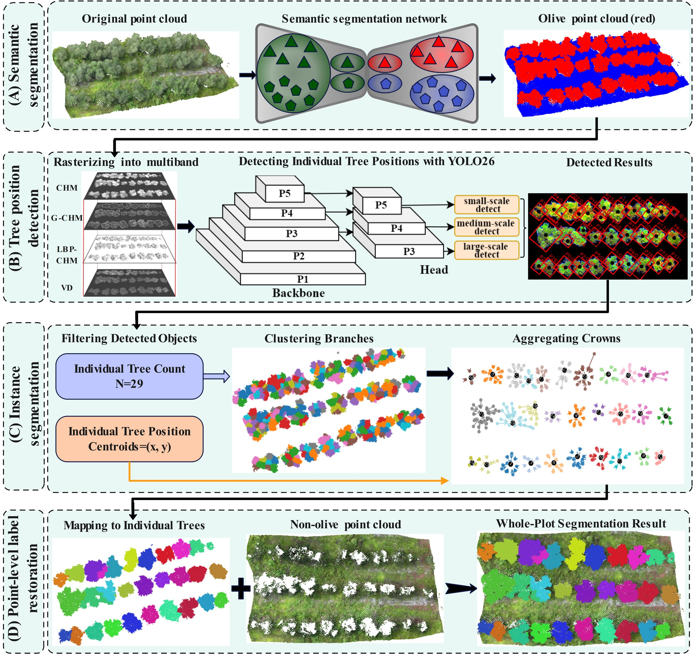

# A Hierarchical Pipeline for Individual Olive Tree Segmentation from UAV LiDAR Point Clouds



Accurate individual tree segmentation from UAV LiDAR point clouds is fundamental to orchard resource assessment and precision management. Traditional individual tree segmentation methods rely on trunk returns to identify individual trees, but they are unsuitable for olive trees because evergreen canopies block the LiDAR returns from trunks.  In this study, we propose a hierarchical pipeline that segments the individual tree  without trunk information. Extracting the olive tree points from the backgrounds with PointMLP backbone. Maping the olive tree points into raster image with four-features, and predicting the trunk location with YOLO26. The core Branch--to--Tree Aggregation (BTA) module then clusters local branch fragments and reassembles them into complete tree instances via seed-guided spatial assignment, effectively resolving pruning-induced over-segmentation.

## Installation

```shell
#step 1. create a conda virtual environment and activate it
conda create -n olive_seg python=3.8.20 -c conda-forge -y
conda activate olive_seg

#step 2.
# torch
conda install pytorch==1.10.1 torchvision==0.11.2 torchaudio==0.10.1 cudatoolkit=11.3 -c pytorch -c conda-forge
# pointMLP
pip install cycler==0.12.1 einops==0.8.1 h5py==3.11.0 pyyaml==5.4.1 scikit-learn==0.24.2 scipy==1.10.1 tqdm==4.68.4 matplotlib==3.3.2
pip install "cloth-simulation-filter<1.1.7" -i https://pypi.tuna.tsinghua.edu.cn/simple
git 
pip install pointnet2_ops_lib/.
# yolo
#pip install ultralytics==8.4.78
cd ./ultralytics
python -m pip install -e . --no-deps

```


## Dataset Download

The data can be downloaded at Baidu Drive with the code of 6666. The data is organized as:

```
AerialTrees.rar
├── Gaofeng
│   ├── plot_1.ply
│   ├── plot_2.ply
│   └── ...
└── Mulan
    └── ...
```


## Train

```shell
#执行语义分割训练
cd semantic_seg
python main_olive.py \
--model pointMLP_olive  \
--exp_name olive_seg   \
--data_root ./../olive_data \
--num_points 4096   \
--block_size 4.0   \
--stride 2.0   \
--batch_size 16   \
--test_batch_size 8


#执行实例分割训练
# 1.点云数据波段特征提取
cd instance_seg
python generate_4ch_features.py \
--input-dir ./../olive_data/train \
--output-dir ./olive_data_4ch_features/train \
--semantic-id 1 \
--resolution 0.10 \
--voxel-size 0.25 \
--dtm-method csf \
--dtm-resolution 0.5 \
--csf-cloth-resolution 0.5 \
--columns "0,1,2,6"

python generate_4ch_features.py \
--input-dir ./../olive_data/val \
--output-dir ./olive_data_4ch_features/val \
--semantic-id 1 \
--resolution 0.10 \
--voxel-size 0.25 \
--dtm-method csf \
--dtm-resolution 0.5 \
--csf-cloth-resolution 0.5 \
--columns "0,1,2,6"

#2.制作yolo格式数据集
python build_yolo_format_dataset.py \
--has-instance-id \
--columns "0,1,2,6,7" \
--train-point-dir ./../olive_data/train \
--train-feature-dir ./olive_data_4ch_features/train \
--val-point-dir ./../olive_data/val \
--val-feature-dir ./olive_data_4ch_features/val \
--output-dir ./olive_data_yolo_format \
--semantic-id 1 \
--min-points 30 \
--min-box-size 2.0

#可视化检查脚本（可选）
python visualize_yolo_format_datasets.py \
--dataset-dir ./olive_data_yolo_format \
--output-dir  olive_data_yolo_format_visualize \
--split val \
--channels 1,2,3 \
--limit 0 \
--show-id
# 其中通道选择可以用名称或索引：：
--channels VD,CHM,G_CHM
--channels CHM,G_CHM,LBP_CHM
--channels 0,1,2
--channels 1,2,3

# 3.启动训练
yolo detect train \
model=yolo26n.yaml \
data=./olive_data_yolo_format/olive_4ch.yaml \
imgsz=640 \
epochs=300 \
batch=16 \
hsv_h=0 hsv_s=0 hsv_v=0 \
mixup=0.0 \
cutmix=0.0 \
auto_augment=None \
erasing=0.0 \
optimizer=AdamW \
lr0=0.001 \
weight_decay=0.0005 \
patience=80 \
project=/workspace/instance_seg/yolo_runs_olive \
name=yolo26n_olive_train

#验证测试指标(可选)
yolo detect val \
model=./yolo_runs_olive/yolo26n_olive_train/weights/best.pt \
data=./olive_data_yolo_format/olive_4ch.yaml \
imgsz=640 \
batch=16 \
split=val \
project=/workspace/instance_seg/yolo_runs_olive \
name=yolo26n_olive_val


```


## validation

```shell
#执行预测
# 1.语义预测
cd semantic_seg
python main_olive.py \
--model pointMLP_olive \
--exp_name olive_seg \
--model_type insiou \
--num_points 4096 \
--block_size 4.0 \
--stride 2.0 \
--test_batch_size 4 \
--inference True \
--inference_input_dir ./../olive_data/test \
--inference_output_dir ./inference/olive_data_pointMLP_predictions
# 2.转换到原始坐标
python restore_raw_coords.py  \
--src-dir ./../olive_data/test \
--pred-dir ./inference/olive_data_pointMLP_predictions \
--out-dir ./../instance_seg/olive_data_pointMLP_predictions \
--overwrite
  

# 2.提取语义结果后的四波段特征
cd instance_seg
python generate_4ch_features.py \
--input-dir olive_data_pointMLP_predictions \
--output-dir ./olive_data_4ch_features/test \
--semantic-id 1 \
--resolution 0.10 \
--voxel-size 0.25 \
--dtm-method csf \
--dtm-resolution 0.5 \
--csf-cloth-resolution 0.5 \
--columns "0,1,2,8"

# 3.转换为yolo格式数据
python build_yolo_format_dataset.py \
--no-instance-id \
--columns "0,1,2,8" \
--test-point-dir ./olive_data_pointMLP_predictions \
--test-feature-dir  ./olive_data_4ch_features/test \
--output-dir ./olive_data_yolo_format \
--semantic-id 1 \
--min-points 10 \
--min-box-size 2.0

# 4.yolo预测
yolo detect predict \
model=./yolo_runs_olive/yolo26n_olive_train/weights/best.pt \
source=./olive_data_yolo_format/images/test \
imgsz=640 \
conf=0.10 \
iou=0.5 \
max_det=1000 \
save_txt=True \
save_conf=True \
save=False \
plots=False \
project=/workspace/instance_seg/yolo_runs_olive \
name=yolo26n_olive_test

# 可视化yolo框的预测结果（可选）
python visualize_yolo_predictions.py \
--dataset-dir ./olive_data_yolo_format \
--split test \
--pred-label-dir ./yolo_runs_olive/yolo26n_olive_test/labels \
--output-dir ./olive_data_yolo_predictions_visualize \
--channels 1,2,3 \
--conf-threshold 0.5 \
--show-conf \
--draw-centers \
--center-radius 5

# 5.根据过滤条件过滤错误框，并将预测的边界框坐标转换到点云的原始坐标系：
python map_yolo_predictions_to_pointcloud.py \
--point-dir ./olive_data_pointMLP_predictions \
--feature-dir ./olive_data_4ch_features/test \
--pred-label-dir ./yolo_runs_olive/yolo26n_olive_test/labels \
--output-point-dir ./yolo_predictions_to_pointcloud \
--output-box-dir ./yolo_boxes_to_coordinate \
--conf-threshold 0.50 \
--min-area-ratio 0.30 \
--center-distance-stat min \
--center-distance-scale 1.0 \
--overlap-threshold 0.5

#对过滤后的框进行二维可视化(可选)
python visualize_mapped_boxes.py \
--box-dir ./yolo_boxes_to_coordinate \
--dataset-dir ./olive_data_yolo_format \
--feature-dir ./olive_data_4ch_features \
--split test \
--output-dir ./yolo_maped_points_boxes_visual \
--channels CHM,G_CHM,LBP_CHM \
--show-id \
--show-conf

# 6.BTA module aggregation
python branch_to_tree_aggregate.py \
--point-dir ./olive_data_pointMLP_predictions \
--box-dir ./yolo_boxes_to_coordinate \
--output-dir ./BTA_aggregate_result \
--semantic-id 1 \
--conf-threshold 0.5 \
--birch-factor 20 \
--threshold 0.7 \
--use-box-constraint \
--outside-box-policy nearest \
--outside-cluster-distance 7 \
--cylinder-radius 0.25 \
--cylinder-z-mode mid

```


## inference


